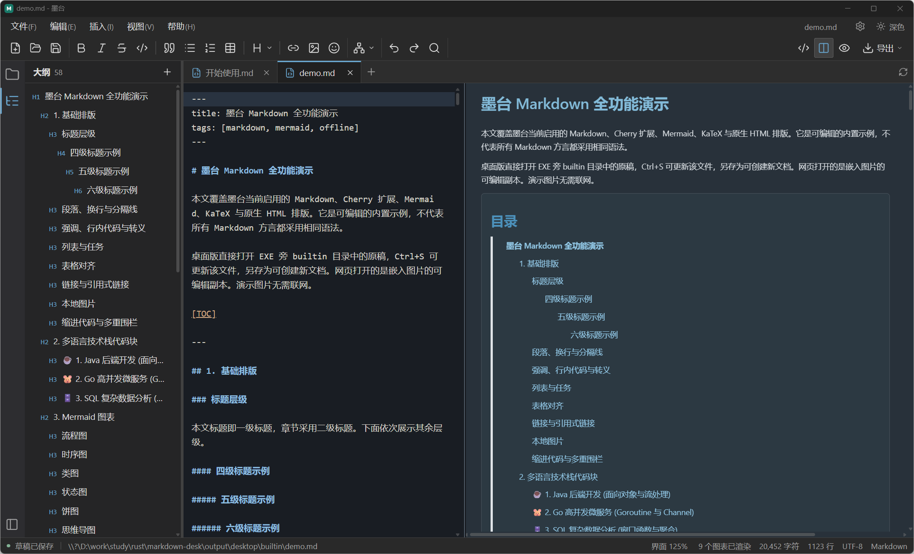
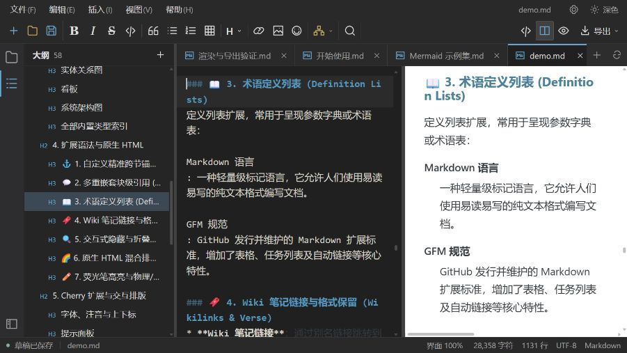
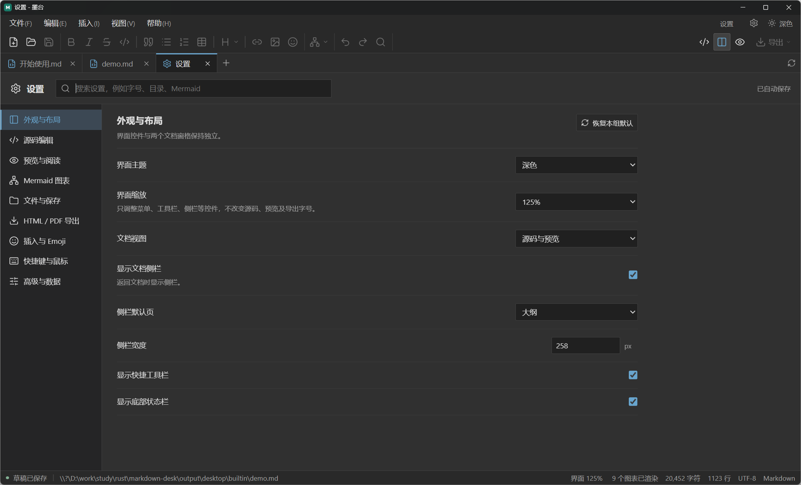
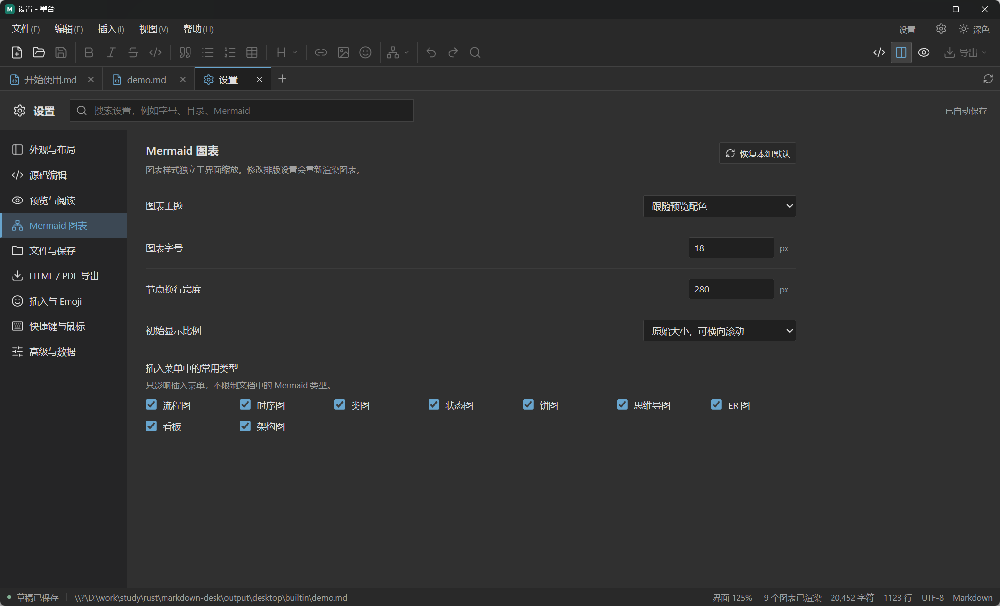
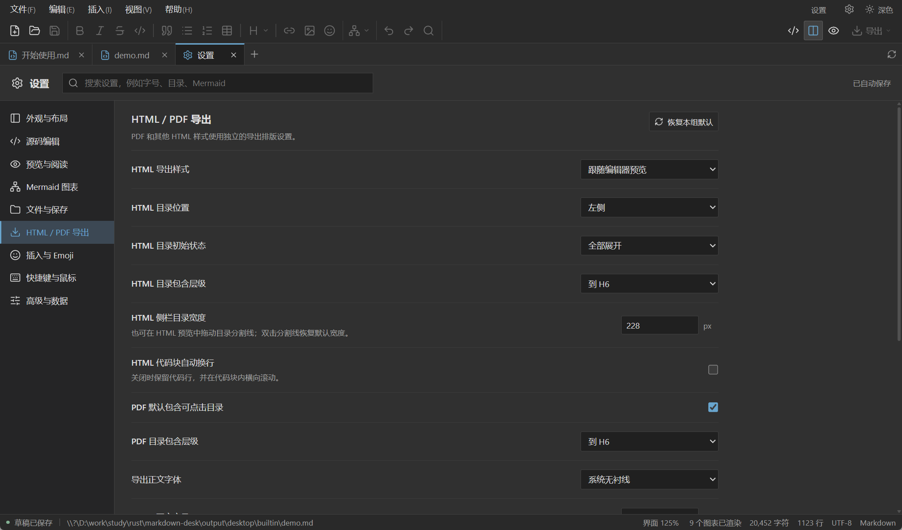
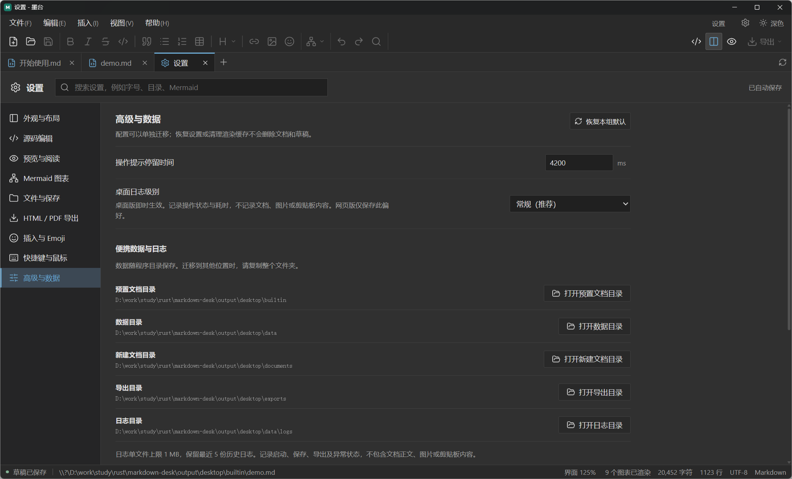
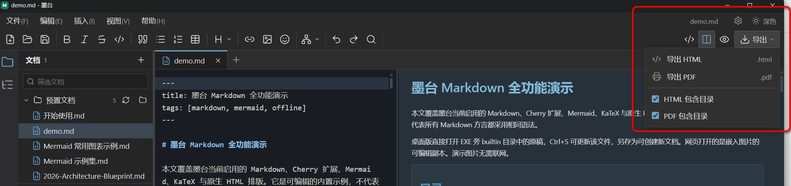
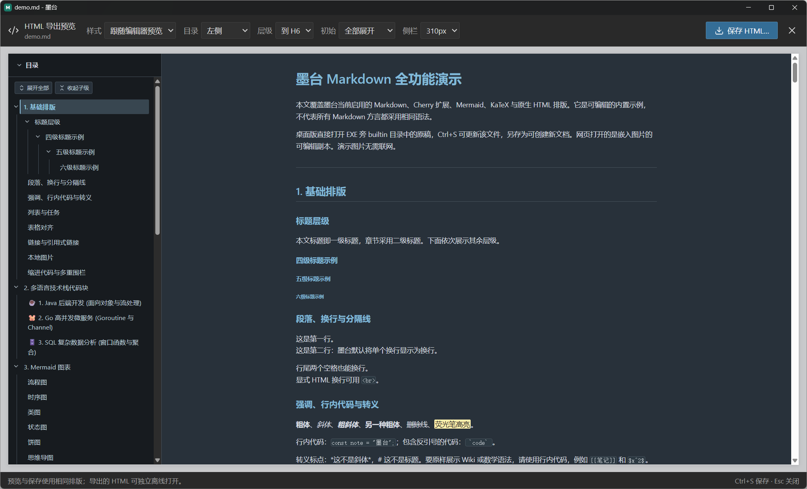
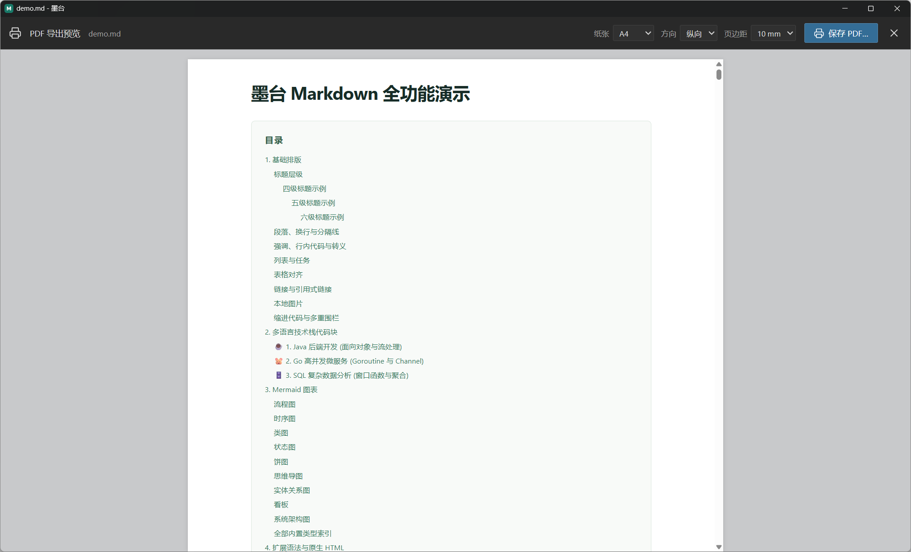

# 墨台 · Markdown Desk

面向技术文档的本地 Markdown 编辑器：左侧写源码，右侧看预览，支持 Mermaid、KaTeX，以及带目录的独立 HTML / PDF 导出。

桌面端使用 **Tauri 2 + 系统 WebView2**，发布为 Windows x64 单文件 EXE；前端使用 **Vue 3 + Cherry Markdown**。日常编辑不需要 Node.js、本地 HTTP 服务或在线编辑平台。



## 为什么开发

项目围绕几项常用的技术写作需求展开：

- 保留 Markdown 源码编辑，同时对照实时预览。
- 在本机查看流程图、时序图、类图等 Mermaid 图表，处理长标签和宽图。
- 导出可以独立分享的 HTML，调整目录位置、正文宽度和排版后再保存。
- 直接生成 PDF 文件，保留可选择的文字、SVG 图表和章节书签。
- 使用本地文件和草稿，不将文档交给远程编辑服务。

## 主要功能

- **编辑与工作区**：源码 / 分栏 / 预览三种模式，多标签页，文件夹与最近文件，查找替换，自定义右键菜单，本地草稿恢复。
- **阅读与布局**：标题大纲、页内锚点跳转、同步滚动、可拖动分隔线；界面缩放与两个文档窗格的字号分别控制。
- **Markdown**：标题、列表、任务、表格、代码高亮、引用、链接、图片、脚注、定义列表、Wiki 别名链接、Verse 行块、高亮与上下标。
- **图表与公式**：使用独立的 Mermaid 引擎，常用插入菜单保留九类图表；支持 KaTeX 行内与块级公式。图表可缩放、适应宽度和放大查看。
- **Unicode Emoji**：按类别与子类选择，支持中文 / 英文搜索；人物表情提供适用的肤色选择，内置字体补充国旗字形。
- **HTML 导出**：先预览再保存，提供 GitHub、技术文档、Material、深色和经典样式；目录可左置、右置、置顶或隐藏，支持折叠与宽度拖动。
- **PDF 导出**：纸张、方向、页边距和目录可配置，不调用实体打印机。
- **设置与诊断**：独立设置标签页、搜索、即时保存、分类恢复默认和设置导入 / 导出；桌面端提供本地滚动日志与目录入口。

## 界面截图

<details>
<summary>编辑示例与设置</summary>











</details>

<details>
<summary>HTML 与 PDF 导出</summary>







</details>

## 内置演示

在软件中选择 **帮助 → Markdown 全功能演示**，也可从同一菜单的“预置 Markdown”列表打开其他示例。

- [demo.md](builtin/demo.md)：覆盖当前启用的基础语法、扩展排版、九类实时图表、公式、HTML 与导出场景。
- [关联笔记](builtin/2026-Architecture-Blueprint.md)：演示 Wiki 别名与笔记往返导航。
- 演示包含当前 Mermaid 的全部 **37 个图表 / 别名模板**。常用九类直接预览，其他类型以可复制源码呈现。
- 桌面版直接读取 EXE 旁的 `builtin/` 文件，Ctrl+S 可更新原稿；需要作为新文档使用时可另存为。网页使用编译时的可编辑副本，演示图片会内嵌。
- “开始使用”、两份 Mermaid 示例、完整演示和关联笔记均有独立 `.md` 原稿，集中保存在 `builtin/`。

Markdown 扩展在不同平台上的解析可能不同，完整效果请在墨台中查看。修改 Mermaid 模板后可运行 `npm run demo:update` 同步演示章节。

## 使用桌面版

从仓库的 Releases 页面获取 Windows x64 单文件 EXE，或按下文从源码构建。源码仓库不包含安装程序，也不需要将开发依赖与 EXE 一起分发。

1. 确认系统已安装 [Microsoft WebView2 Runtime](https://developer.microsoft.com/microsoft-edge/webview2/)。运行时复用系统组件，不嵌入 EXE。
2. 运行 `墨台.exe`，使用“打开”选择 `.md` / `.markdown` / `.txt` 文件。
3. 在「设置 → 文件与保存」可以添加或撤销墨台的 `.md` 打开方式登记，也可以清理列出的打开记录、重复墨台登记和失效程序项。点击「设为 .md 默认应用…」会自动完成必要的登记，并打开 Windows 默认应用设置供你确认。

也可拖入文件或从命令行传入路径。同一目录再次启动时，文件会交给已有窗口；不同目录的便携副本独立运行。测试新构建前应退出旧进程。

### 文件与草稿

- 自动保存的是工作区草稿；**保存 / Ctrl+S** 才会明确写回 Markdown 文件。
- 桌面数据保存在 EXE 所在文件夹内，按用途分类；新建文档直接保存到 `documents/`，未写回原文件的编辑内容仍由草稿恢复。保存文件使用临时文件和原子替换，并检测外部修改。
- 相对图片按原 Markdown 所在目录解析。普通文档另存到其他目录时，应同时保留相关资源。
- 程序不上传文档、不接入远程 AI 服务。文档中的外链图片和主动点击的网络链接仍可能访问相应网站。

### 便携目录与迁移

```text
墨台.exe
builtin/                 预置 Markdown，可直接维护；assets/ 保存示例图片
data/
  config/                settings.json、preferences.json 与迁移标记
  drafts/                workspace.json（文档草稿、标签页与最近文件）
  cache/                 diagram-cache.json、PDF 临时任务
  logs/                  motai.log 与滚动历史日志
  webview/<本机标识>/     WebView2 本机运行数据
documents/               新建的 Markdown 文件
exports/                 html/、pdf/、svg/、settings/（按需创建）
```

“设置 → 高级与数据”显示实际目录，可直接打开数据、文档、导出和日志文件夹。设置 JSON 是桌面偏好的主存储，WebView 中只保留同步副本。

首次运行新版时，会复制旧系统目录中尚未迁移的草稿、图表缓存和偏好，保留原数据且不覆盖已有便携文件；请先退出旧版。迁移后更新 EXE 即可。移动到其他位置或电脑时，复制整个文件夹，程序会调整目录内的文档引用；外部文档和普通 Markdown 内的资源路径保持原样。WebView2 运行目录按本机账户隔离，跨电脑复用的是 JSON 文档与配置。

程序目录需要可写；若放在只读位置，会明确提示移动到可写文件夹，不静默回退到系统应用目录。网页版本仍使用当前浏览器站点的本地存储。

### 更新预置 Markdown

桌面程序启动时会补齐 `builtin/` 中缺失的默认文档和图片，**已有文件一律保留，包括空文件和用户修改的图片**。更新 EXE 不会替换这个目录里的原稿。

启动时只读取文件列表，显示在左侧“预置文档”目录树中，不自动打开或渲染示例。点击文件名时才读取正文；网页内置示例模块同样按需加载。预置文档不自动恢复为启动标签页，已有草稿会保留。

可以直接修改其中的 Markdown，或加入自己的 `.md` 文件和子目录。在目录树或“帮助”菜单重新选择文档就会读取磁盘最新内容；新增文件可通过“刷新预置文档目录”立即加入列表。目录树旁、帮助菜单和设置页均有打开预置目录的入口。

若磁盘文件和编辑器草稿同时有修改，重新读取前会把编辑器内容保留为“磁盘更新前草稿”，随后载入磁盘版本。直接编辑预置文档后按 Ctrl+S 会写回 `builtin/`；使用模板写新文档时请另存为，避免改动原稿。

网页版本使用构建时的预置内容；修改源码 `builtin/` 后需重新构建并刷新网页。桌面 EXE 旁的预置目录无需重新打包。

### 本地日志

日志使用 Tauri 官方日志插件，默认级别为“常规”，可在设置中即时切换为详细诊断、警告或仅错误。使用本地时间，记录版本、启动阶段、迁移结果、文件打开 / 保存、导出结果和异常状态；详细级别另记录草稿、配置和缓存写入耗时。日志不收集文档正文、图表源码、图片、剪贴板或任意控制台输出。

单个日志达到 1 MiB 后自动轮换，最多保留 5 份历史日志。排查问题时可从设置页打开 `data/logs/`，结合界面错误提示提供对应时间段的日志。关闭程序后可以删除历史日志。

## 从源码运行

### 环境

| 用途 | 要求 |
| --- | --- |
| 网页开发与测试 | Node.js 22.14+ 的 22.x 分支，或 Node.js 24+；npm |
| Windows EXE 构建 | Rust stable MSVC 工具链、Visual Studio C++ Build Tools、Windows SDK |
| 桌面运行 | Windows 10 / 11 x64 与 WebView2 Runtime |
| 网页 PDF 调试 | 本机已安装 Edge 或 Chrome |

目前只验证 Windows 桌面版。Tauri 的其他桌面平台尚未接入对应的原生 PDF 实现。

### 安装与开发

在项目根目录执行：

```bash
npm ci
npm run dev
```

打开 <http://127.0.0.1:4318/>。开发服务器仅绑定本机地址。

运行生产构建的本地预览及网页 PDF 服务：

```bash
npm run build
npm start
```

Windows 也可以双击 `启动.cmd`。浏览器草稿按站点地址与端口隔离，切换端口不会自动迁移草稿；需要长期保留的文档请显式保存为文件。

### 构建单文件 EXE

```bash
npm run build:desktop
```

输出为 `output/desktop/墨台.exe`。构建使用 `--no-bundle`，不生成 MSI / NSIS 安装包；可用 `MARKDOWN_DESK_EXE_NAME` 环境变量指定文件名。

脚本使用 PATH 中由 rustup 管理的 Rust MSVC 工具链，版本由根目录 `rust-toolchain.toml` 固定；工具链、Cargo 和 npm 下载缓存由用户环境统一管理，不安装到项目目录。首次构建需要下载缺少的组件和依赖。

桌面编译缓存默认放在用户目录的 `.cache/rust-build/markdown-desk/`；可设置用户环境变量 `RUST_BUILD_CACHE_ROOT` 统一调整缓存根目录，或用 `CARGO_TARGET_DIR` 指定完整的编译目录。发布 EXE 仍输出到 `output/desktop/`。

### 构建 Windows 安装包

```bash
npm run build:installers
```

`output/installers/` 会生成两个 Windows x64 安装程序。用户级安装为当前账户安装，默认位于 `%LOCALAPPDATA%\墨台`，无需管理员权限。系统级安装为所有账户安装，默认位于 `%ProgramFiles%\墨台`，需要管理员权限。选择其中一种即可。

两种安装版都在当前账户的 `%LOCALAPPDATA%\MarkdownDesk` 保存草稿、设置、新建文档和默认导出文件。便携版继续使用 EXE 旁的数据目录。系统缺少 WebView2 Runtime 时，安装程序会使用内置的引导程序联网安装。

### 测试与示例维护

```bash
npm test
npm run demo:check
npm run build
```

原生模块可另外运行：

```bash
cargo test --manifest-path src-tauri/Cargo.toml
```

自动测试覆盖设置、草稿队列、导航、缓存、导出与语法边界。内置演示使用真实 Cherry / KaTeX 引擎进行隔离 DOM 测试，并校验全部 Mermaid 模板的语法；这不等同于所有系统、字体和复杂图表的视觉验收。

可选维护脚本包括 `scripts/subset-flag-font.py` 与 `scripts/update-emoji-categories.mjs`。它们用于更新已经提交的字体和 Emoji 数据，不是普通开发或应用运行的前置条件。

## 技术栈与主要依赖

| 层次 | 项目 | 用途 |
| --- | --- | --- |
| 界面 | [Vue](https://github.com/vuejs/core) | 工作区、菜单、设置与导出预览 |
| 编辑与解析 | [Cherry Markdown](https://github.com/Tencent/cherry-markdown) / CodeMirror | 源码编辑、Markdown 渲染与扩展钩子 |
| 图表 | [Mermaid](https://github.com/mermaid-js/mermaid) | 本地图表生成与 SVG |
| 数学 | [KaTeX](https://github.com/KaTeX/KaTeX) | 数学公式与字体 |
| 清理 | [DOMPurify](https://github.com/cure53/DOMPurify) | HTML 与缓存 SVG 的清理 |
| 桌面 | [Tauri](https://github.com/tauri-apps/tauri) 与官方插件 | 窗口、本地文件、对话框、剪贴板和单实例 |
| 本地日志 | [tauri-plugin-log](https://github.com/tauri-apps/plugins-workspace/tree/v2/plugins/log) / [log](https://github.com/rust-lang/log) | 分级诊断、文件轮换和大小限制 |
| 原生 PDF | WebView2 / [webview2-rs](https://github.com/wravery/webview2-rs) / [lopdf](https://github.com/J-F-Liu/lopdf) | 打印到 PDF 与 Unicode 章节书签 |
| 网页 PDF | [Playwright](https://github.com/microsoft/playwright) / [pdf-lib](https://github.com/Hopding/pdf-lib) | 复用本机浏览器生成调试用 PDF，不打入桌面 EXE |
| 构建与测试 | [Vite](https://github.com/vitejs/vite) / [jsdom](https://github.com/jsdom/jsdom) / Node test runner | 前端构建与隔离 DOM 回归测试 |

依赖使用精确版本和锁文件。实际版本以 `package-lock.json`、`src-tauri/Cargo.lock` 为准；测试用 jsdom 选择与项目最低 Node 版本兼容的分支。

## 项目结构

```text
builtin/                 内置 Markdown 与本地示例图片
src/                     Vue 工作区、渲染、设置、导出与平台适配
src-tauri/               Rust 文件操作、原生 PDF、窗口与启动流程
public/                  启动页样式、图标与第三方许可说明
scripts/                 构建、本地预览、PDF 和数据维护工具
tests/                   单元测试与真实引擎集成测试
docs/                    界面示例等仓库文档资源
```

`node_modules/`、`dist/`、`.cache/` 和 `output/` 是安装或构建产物，不应提交到 Git。性能记录见 [PERFORMANCE.md](PERFORMANCE.md)，版本变化见 [CHANGELOG.md](CHANGELOG.md)。

## 支持边界

- Wiki 语法支持别名、当前笔记章节与本地关联笔记导航；自动反向链接索引、知识图谱和 `![[笔记嵌入]]` 尚未实现。
- 使用 KaTeX 支持的数学子集，不执行 TeX 宏包、代码块或外部脚本；例如普通文本上标 `X^3^` 和数学公式 `$X^3$` 是不同语法。
- HTML 导出保留阅读交互与目录；编辑器标签页排版会转为展开小节，PDF 会展开折叠内容，以保留全部正文。
- 外链图片能否内嵌到网页导出受源站跨域策略影响。本地文件或已内嵌图片更适合离线分享。
- 桌面版目前处理 HTTP(S)、页内锚点和本地 Markdown 链接，未单独接入其他系统协议。

## 贡献

提交问题时请提供可脱敏的最小 Markdown 示例、软件 / 系统版本、使用模式，以及问题发生在编辑、预览、HTML 还是 PDF 阶段。

修改渲染或语法时应同时检查代码块、公式与转义边界，以及导出是否保留内容。更新示例后运行 `npm run demo:check`；修改原生模块时补充相应 Rust 验证。

## 许可证与致谢

墨台的自有代码采用 MIT 许可证。你可以使用、修改和分发代码，包括用于商业用途。分发代码或其实质部分时，须保留原版权声明和许可声明。许可正文见 [MIT License](https://opensource.org/license/mit)。

随项目分发的第三方代码、图标、字体和数据适用各自的许可证。来源、署名和许可文本见 [THIRD_PARTY_NOTICES.md](THIRD_PARTY_NOTICES.md) 与 [public/licenses](public/licenses)。

感谢上述开源项目，以及 Unicode / CLDR 与 Noto Emoji 提供的标准数据和字形资源。
