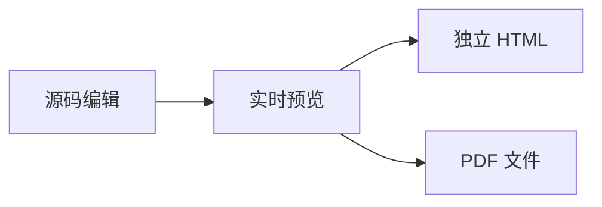

# 2026-Architecture-Blueprint

这是一篇内置关联笔记，用来演示 Wiki 别名链接、相对文档导航与返回原文。

## 设计目标

- Markdown 原文保存在本机。
- 源码与实时预览分栏显示。
- Mermaid、公式与导出资源使用本地依赖。

## 模块关系

## 返回演示

[[demo|返回 Markdown 全功能演示]]

这个链接只负责笔记导航。自动反向链接索引、关系图和 `![[笔记嵌入]]` 是另外的能力，当前版本未实现。

