# 墨台 Markdown 全功能演示

本文覆盖墨台当前启用的 Markdown、Cherry 扩展、Mermaid、KaTeX 与原生 HTML 排版。它是可编辑的内置示例，不代表所有 Markdown 方言都采用相同语法。

桌面版直接打开 EXE 旁 builtin 目录中的原稿，Ctrl+S 可更新该文件，另存为可创建新文档。网页打开的是嵌入图片的可编辑副本。演示图片无需联网。

[TOC]

---

## 1. 基础排版

### 标题层级

本文标题即一级标题，章节采用二级标题。下面依次展示其余层级。

#### 四级标题示例

##### 五级标题示例

###### 六级标题示例

### 段落、换行与分隔线

这是第一行。
这是第二行：墨台默认将单个换行显示为换行。

行尾两个空格也能换行。  
显式 HTML 换行可用 `<br>`。

### 强调、行内代码与转义

**粗体**、*斜体*、***粗斜体***、**另一种粗体**、~~删除线~~、==荧光笔高亮==。

行内代码：`const note = "墨台";`；包含反引号的代码：`` `code` ``。

转义标点：\*这不是斜体\*，\# 这不是标题。要原样展示 Wiki 或数学语法，请使用行内代码，例如 `[[笔记]]` 和 `$x^2$`。

HTML 实体：&lt;tag&gt;、&amp;、&copy;。

### 列表与任务

- 无序列表
  - 嵌套子项
  - 另一个子项
- 另一项

1. 有序列表
2. 第二项
   1. 嵌套有序项

- [x] 已完成任务
- [ ] 待办任务

### 表格对齐

| 左对齐 | 居中 | 右对齐 |
| :--- | :---: | ---: |
| Markdown | 中文 | 123.45 |
| `code` | **粗体** | 7 |

### 链接与引用式链接

[项目关联笔记](2026-Architecture-Blueprint.md)、[[2026-Architecture-Blueprint|Wiki 别名链接]]、[[#1. 基础排版|本页 Wiki 跳转]]。

[CommonMark 规范][commonmark-spec] 与 [GFM 规范][gfm-spec] 展示引用式链接。

自动链接：https://example.com

显式链接：[https://example.org](https://example.org)。邮箱文字示例：`reader@example.com`。桌面版目前处理 HTTP(S) 与本地 Markdown 导航，其他系统协议没有单独接入。

### 本地图片

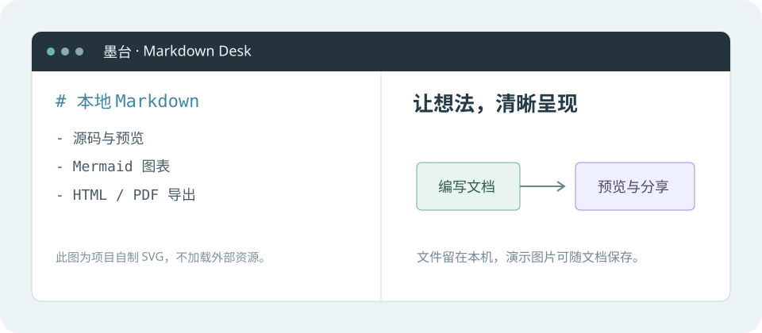

### 缩进代码与多重围栏

    四个空格开始的缩进代码
    H~2~O 与 [[Wiki]] 在代码中保持原样。

```text
反引号围栏支持语言名称。
```

````markdown
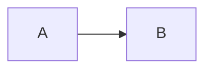
````

上方四重围栏内的图表是语法示例，不会当作实际图表执行。

---

## 2. 多语言技术栈代码块

### ☕ 1. Java 后端开发 (面向对象与流处理)
```java
package com.demo.service;

import java.util.List;
import java.util.stream.Collectors;

/**
 * 订单处理服务实现类
 */
public class OrderServiceImpl implements OrderService {
    
    @Override
    public List<String> filterHighValueOrders(List<Order> orders, double threshold) {
        return orders.stream()
                .filter(order -> order.getAmount() > threshold)
                .map(Order::getOrderId)
                .collect(Collectors.toList());
    }
}
```

### 🐹 2. Go 高并发微服务 (Goroutine 与 Channel)
```go
package main

import (
	"fmt"
	"time"
)

// Worker 异步处理管道数据的消费者
func Worker(id int, jobs <-chan int, results chan<- int) {
	for j := range jobs {
		fmt.Printf("Worker %d 开始处理任务 %d\n", id, j)
		time.Sleep(time.Millisecond * 500) // 模拟耗时任务
		results <- j * 2
	}
}

func main() {
	jobs := make(chan int, 100)
	results := make(chan int, 100)
	go Worker(1, jobs, results)
}
```

### 🗄️ 3. SQL 复杂数据分析 (窗口函数与聚合)
```sql
-- 计算每个部门薪资前三名的员工及其与部门平均薪资的差值
WITH RankedEmployees AS (
    SELECT 
        employee_id,
        department_id,
        salary,
        DENSE_RANK() OVER (PARTITION BY department_id ORDER BY salary DESC) as salary_rank,
        AVG(salary) OVER (PARTITION BY department_id) as dept_avg_salary
    FROM employees
    WHERE status = 'ACTIVE'
)
SELECT 
    employee_id,
    department_id,
    salary,
    (salary - dept_avg_salary) AS diff_from_avg
FROM RankedEmployees
WHERE salary_rank <= 3;
```

---

## 3. Mermaid 图表

<!-- mermaid-demo:start -->

本页直接预览常用九类图表。其他内置类型附在后面的源码索引中，可复制到新文档或替换当前图表后预览。

### 流程图

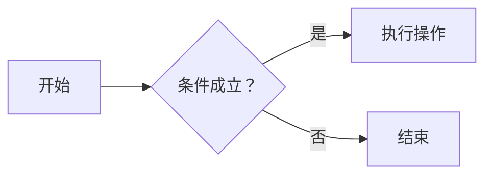


### 时序图

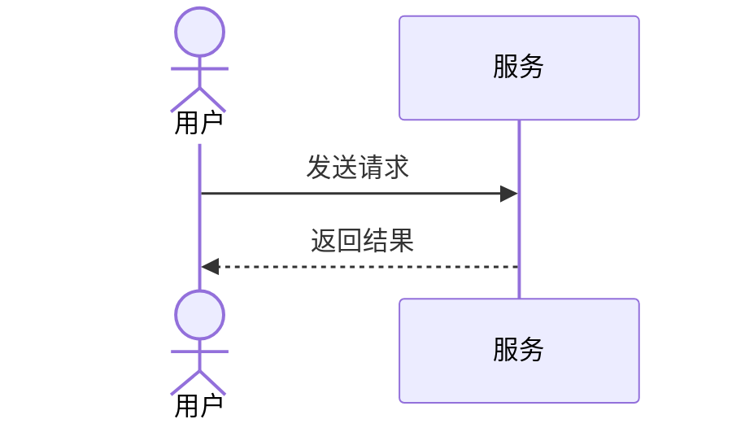


### 类图

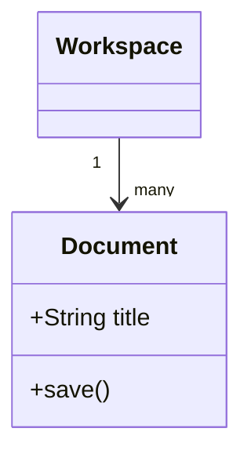


### 状态图

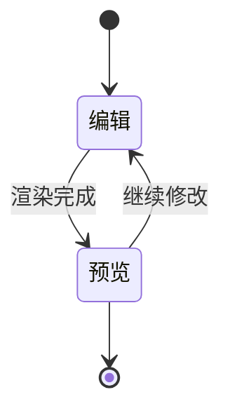


### 饼图

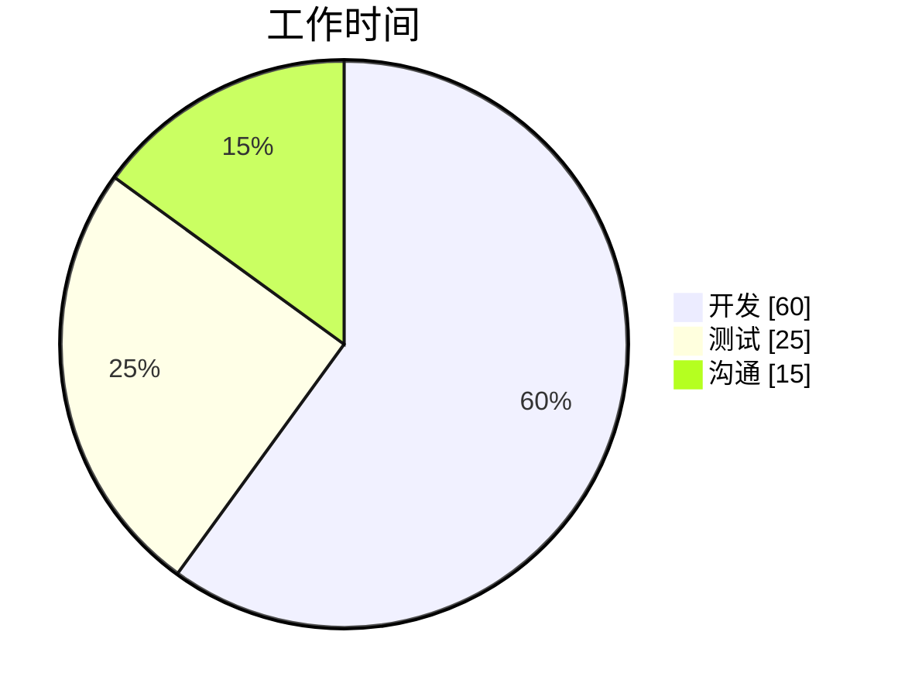


### 思维导图

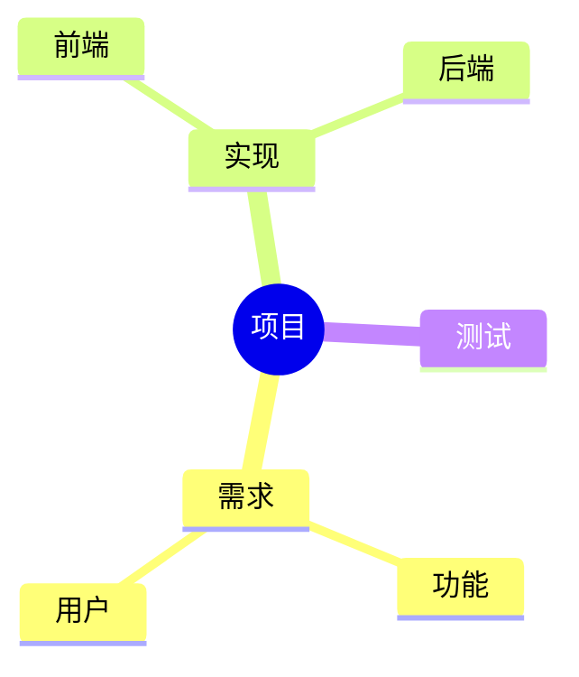


### 实体关系图

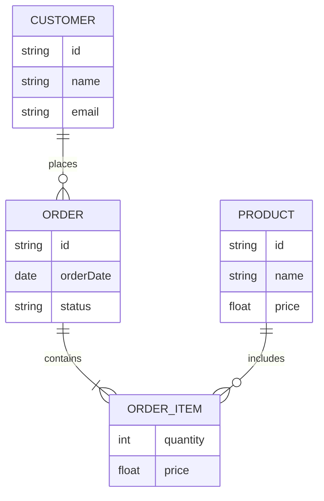


### 看板

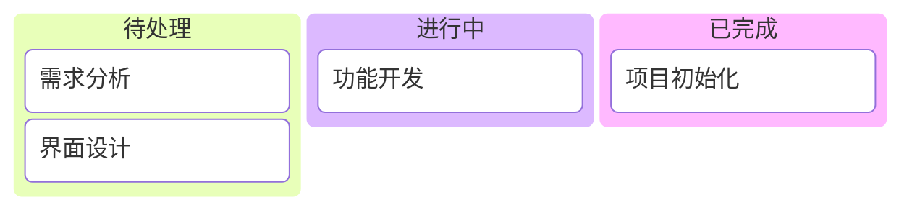


### 系统架构图

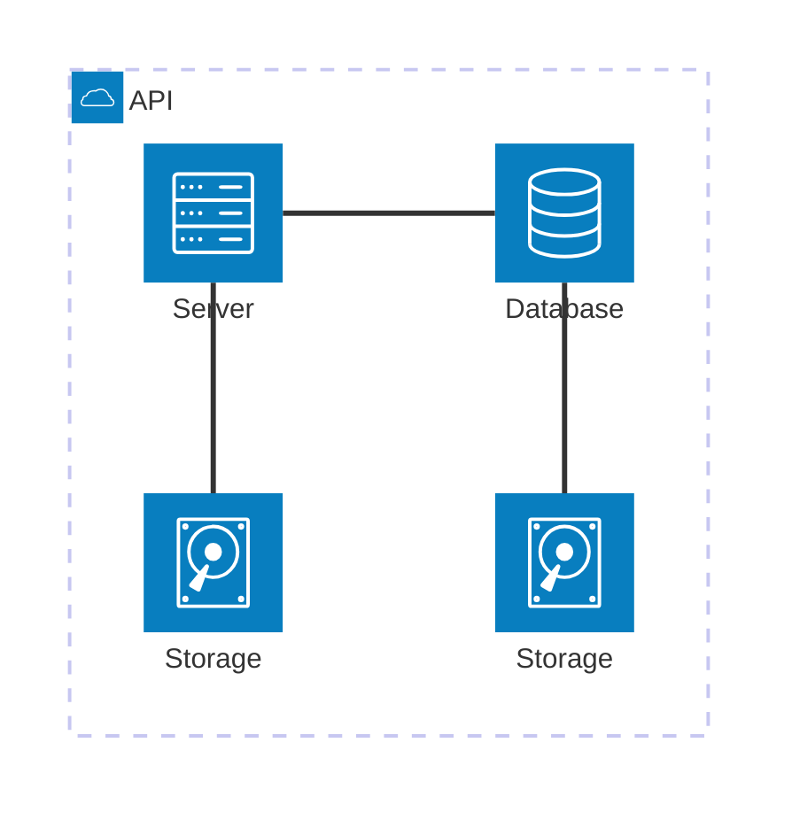


### 全部内置类型索引

| 类型 | Mermaid 起始语法 | 本页展示 |
| --- | --- | --- |
| 流程图 | `flowchart` | 上方直接预览 |
| 流程图 · ELK 布局 | `flowchart-elk` | 下方源码示例 |
| 时序图 | `sequenceDiagram` | 上方直接预览 |
| 类图 | `classDiagram` | 上方直接预览 |
| 状态图 | `stateDiagram-v2` | 上方直接预览 |
| 实体关系图 | `erDiagram` | 上方直接预览 |
| 甘特图 | `gantt` | 下方源码示例 |
| 饼图 | `pie` | 上方直接预览 |
| 思维导图 | `mindmap` | 上方直接预览 |
| 时间线 | `timeline` | 下方源码示例 |
| Git 分支图 | `gitGraph` | 下方源码示例 |
| 用户旅程图 | `journey` | 下方源码示例 |
| 需求图 | `requirementDiagram` | 下方源码示例 |
| C4 架构图 | `C4Context` | 下方源码示例 |
| 象限图 | `quadrantChart` | 下方源码示例 |
| 桑基图 | `sankey-beta` | 下方源码示例 |
| XY 图表 | `xychart-beta` | 下方源码示例 |
| 块图 | `block-beta` | 下方源码示例 |
| 数据包图 | `packet` | 下方源码示例 |
| 看板 | `kanban` | 上方直接预览 |
| 系统架构图 | `architecture-beta` | 上方直接预览 |
| 雷达图 | `radar-beta` | 下方源码示例 |
| 矩形树图 | `treemap-beta` | 下方源码示例 |
| 韦恩图 | `venn-beta` | 下方源码示例 |
| 鱼骨图 | `ishikawa-beta` | 下方源码示例 |
| Wardley 地图 | `wardley-beta` | 下方源码示例 |
| Cynefin 决策图 | `cynefin-beta` | 下方源码示例 |
| 树状目录图 | `treeView-beta` | 下方源码示例 |
| 泳道图 | `swimlane-beta` | 下方源码示例 |
| 用例图 | `usecase-beta` | 下方源码示例 |
| 事件建模图 | `eventmodeling` | 下方源码示例 |
| Agent 流程图 | `agentflow-beta` | 下方源码示例 |
| 语法铁路图 | `railroad-beta` | 下方源码示例 |
| 铁路图 · EBNF | `railroad-ebnf-beta` | 下方源码示例 |
| 铁路图 · ABNF | `railroad-abnf-beta` | 下方源码示例 |
| 铁路图 · PEG | `railroad-peg-beta` | 下方源码示例 |
| Mermaid 版本信息 | `info` | 下方源码示例 |

<details>
<summary>展开其他内置类型的完整源码</summary>


**流程图 · ELK 布局**

````markdown
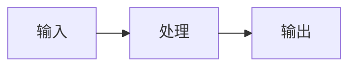
````


**甘特图**

````markdown
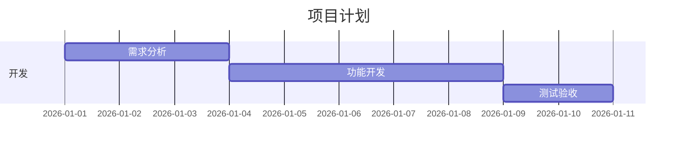
````


**时间线**

````markdown
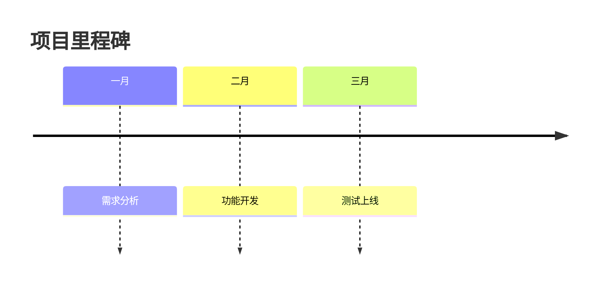
````


**Git 分支图**

````markdown
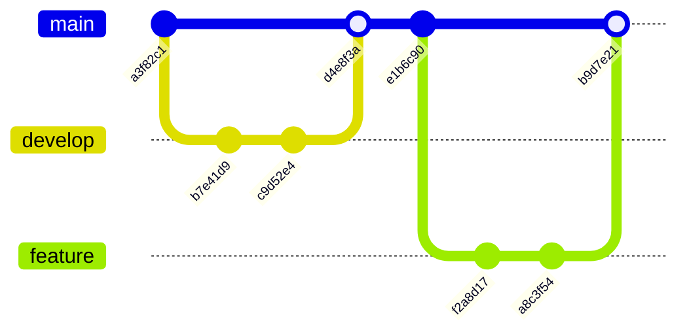
````


**用户旅程图**

````markdown
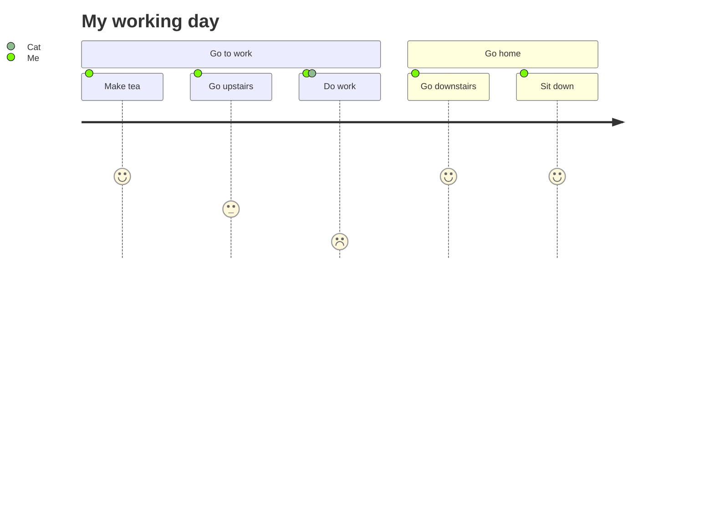
````


**需求图**

````markdown
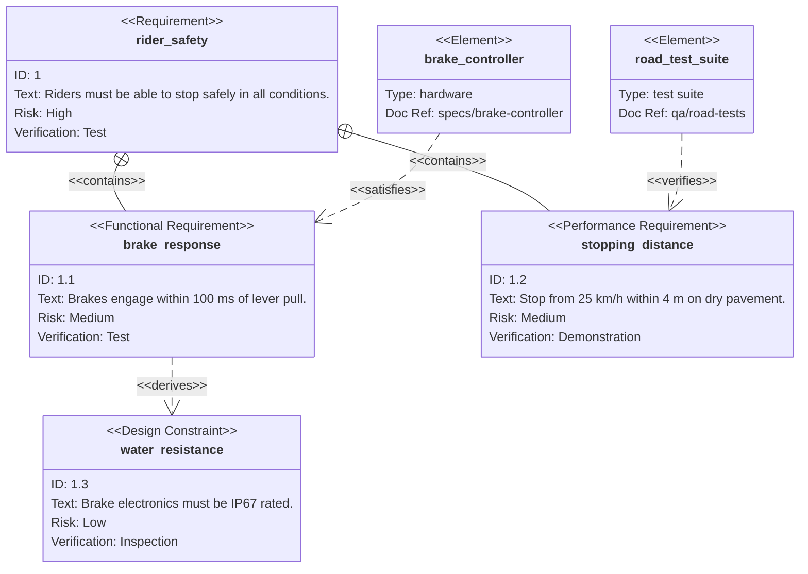
````


**C4 架构图**

````markdown
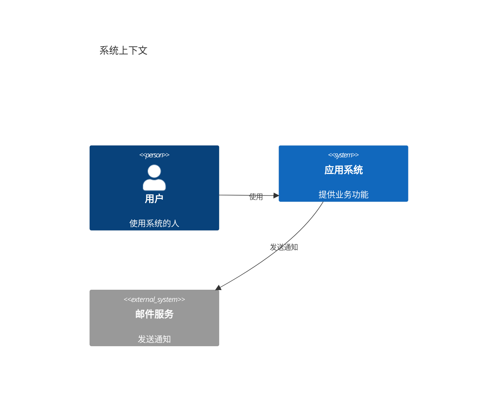
````


**象限图**

````markdown

````


**桑基图**

````markdown
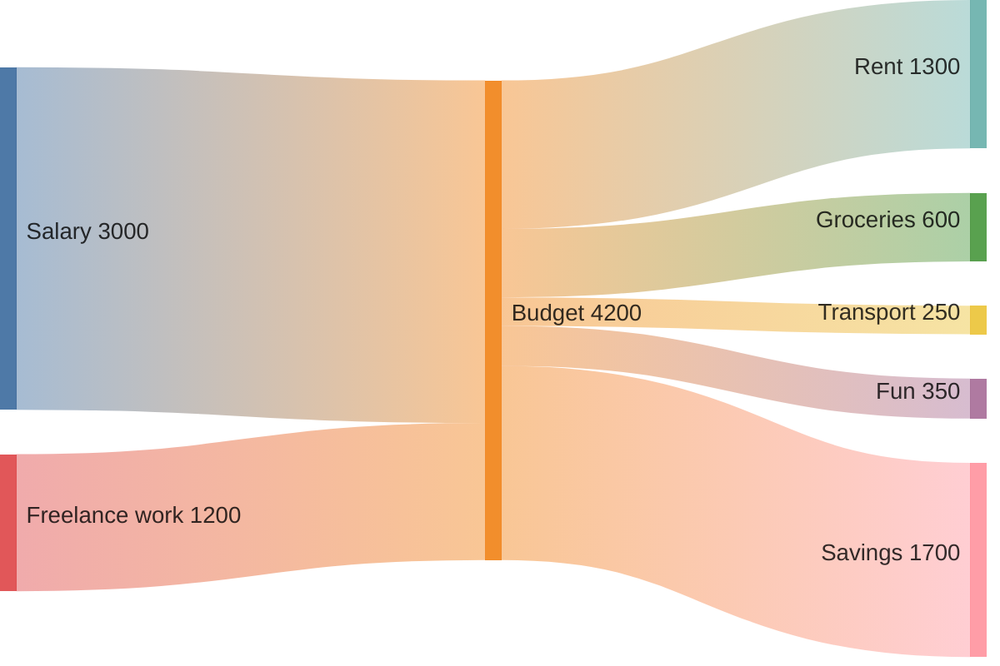
````


**XY 图表**

````markdown
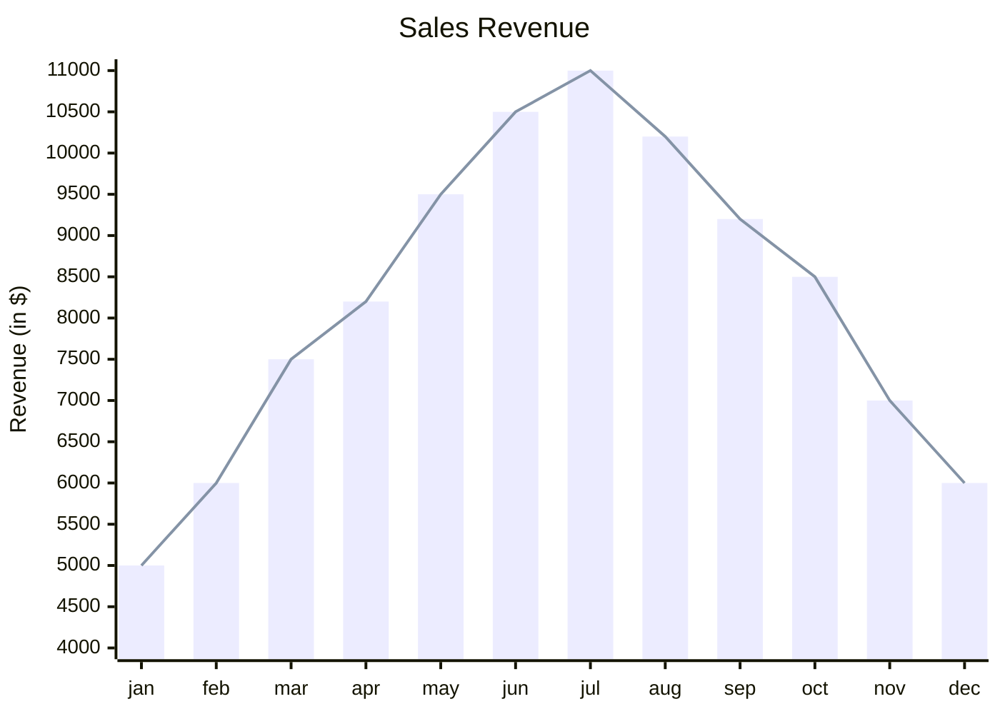
````


**块图**

````markdown
```mermaid
block-beta
  columns 3
  user(("User")):3
  space:3
  ui["Web UI"] api["API Server"] db[("Database")]

  user --> ui
  ui --> api
  api --> db

  style user fill:#ffe0b2,stroke:#fb8c00
  style db fill:#bbdefb,stroke:#1e88e5
```
````


**数据包图**

````markdown
```mermaid
packet
  title 数据包结构
  0-15: "源端口"
  16-31: "目标端口"
  32-63: "序列号"
```
````


**雷达图**

````markdown
```mermaid
radar-beta
  title Frontend Framework Comparison
  axis perf["Performance"], dx["Dev Experience"], eco["Ecosystem"]
  axis learn["Easy to Learn"], docs["Documentation"]

  curve react["React"]{4, 4, 5, 3, 4}
  curve vue["Vue"]{4, 5, 4, 4, 5}
  curve svelte["Svelte"]{5, 5, 3, 4, 4}

  graticule polygon
  max 5
  min 0
```
````


**矩形树图**

````markdown
```mermaid
treemap-beta
"项目预算"
  "开发": 60
  "测试": 25
  "运维": 15
```
````


**韦恩图**

````markdown
```mermaid
venn-beta
    title "Finding the Product Sweet Spot"
    set Desirable
    set Feasible
    set Viable
    union Desirable,Feasible["Worth prototyping"]
    union Feasible,Viable["Cheap to run"]
    union Desirable,Viable["Hard to build"]
    union Desirable,Feasible,Viable["Sweet spot"]
```
````


**鱼骨图**

````markdown
```mermaid
ishikawa-beta
    Blurry Photo
    Process
        Out of focus
        Shutter speed too slow
        Protective film not removed
        Beautification filter applied
    User
        Shaky hands
    Equipment
        LENS
            Inappropriate lens
            Damaged lens
            Dirty lens
        SENSOR
            Damaged sensor
            Dirty sensor
    Environment
        Subject moved too quickly
        Too dark
```
````


**Wardley 地图**

````markdown
```mermaid
wardley-beta
title Tea Shop
size [1100, 800]

anchor Business [0.95, 0.63]
anchor Public [0.95, 0.78]
component Cup of Tea [0.79, 0.61] label [19, -4]
component Cup [0.73, 0.78]
component Tea [0.63, 0.81]
component Hot Water [0.52, 0.80]
component Water [0.38, 0.82]
component Kettle [0.43, 0.35] label [-57, 4]
component Power [0.1, 0.7] label [-27, 20]

Business -> Cup of Tea
Public -> Cup of Tea
Cup of Tea -> Cup
Cup of Tea -> Tea
Cup of Tea -> Hot Water
Hot Water -> Water
Hot Water -> Kettle
Kettle -> Power

evolve Kettle 0.62
evolve Power 0.89

note "Standardising power allows Kettles to evolve faster" [0.30, 0.49]
note "Hot water is obvious and well known" [0.48, 0.80]
note "A generic note appeared" [0.23, 0.33]
```
````


**Cynefin 决策图**

````markdown
```mermaid
cynefin-beta
title Optional Diagram Title

complex
"Item label"
"Another item"

complicated
"Expert analysis needed"

clear
"Known procedure"

chaotic
"Crisis response"

confusion
"Item of unknown domain"

complex --> complicated : "Pattern identified"
clear --> chaotic : "Complacency"
```
````


**树状目录图**

````markdown
```mermaid
treeView-beta
            my-project/
                src/
                    components/
                        Button.tsx
                        Header.tsx
                    App.tsx
                    index.js
                .gitignore
                package.json
                README.md
```
````


**泳道图**

````markdown
```mermaid
swimlane-beta LR
  subgraph Customer
    Browse[Browse catalogue]
    Pay[Pay]
  end
  subgraph Warehouse
    Pick[Pick items]
    Ship[Ship order]
  end
  subgraph Finance
    Invoice[Raise invoice]
  end
  Browse --> Pay
  Pay --> Pick
  Pick --> Ship
  Pay --> Invoice
```
````


**用例图**

````markdown
```mermaid
usecase-beta
actor User("User")
actor Admin("Administrator")
Login("Log in")
ViewProfile("View profile")
ManageUsers("Manage users")
ViewReports("View reports")
User --> Login
User --> ViewProfile
Admin --> ManageUsers
Admin --> ViewReports
```
````


**事件建模图**

````markdown
```mermaid
eventmodeling

tf 01 ui ShopUI
tf 02 cmd AddItemToCart
tf 03 evt ItemAdded
tf 04 rmo CartView ->> 03
tf 05 ui CheckoutUI
tf 06 cmd PlaceOrder
tf 07 evt OrderPlaced
tf 08 rmo OrderStatus ->> 07
```
````


**Agent 流程图**

````markdown
```mermaid
agentflow-beta TB
  flow reviewer["Review Agent"]
    changes["Gather changes"]@{ shape: input }
    analyse["Analyse diff"]@{ shape: task }
    lint["run_linter"]@{ shape: tool }
    ok["Clean?"]@{ shape: decision }

    changes --> analyse --> lint --> ok
  end
```
````


**语法铁路图**

````markdown
```mermaid
railroad-beta
  title 表达式语法
  expression = sequence(nonterminal("number"), terminal("+"), nonterminal("number")) ;
  number = choice(terminal("1"), terminal("2"), terminal("3")) ;
```
````


**铁路图 · EBNF**

````markdown
```mermaid
railroad-ebnf-beta
  title "数字语法"
  digit = "0" | "1" | "2" | "3" ;
```
````


**铁路图 · ABNF**

````markdown
```mermaid
railroad-abnf-beta
  title "数字语法"
  digit = "0" / "1" / "2" / "3" ;
```
````


**铁路图 · PEG**

````markdown
```mermaid
railroad-peg-beta
  title "数字语法"
  Digit <- "0" / "1" / "2" / "3" ;
```
````


**Mermaid 版本信息**

````markdown
```mermaid
info
```
````


</details>

<!-- mermaid-demo:end -->

---

## 4. 扩展语法与原生 HTML

<!-- 🚀 这是一个行内隐藏注释：此处的HTML注释在阅读模式下完全不可见，专门用于团队文档协作、留下开发备注或草稿提示 -->

### ⚓ 1. 自定义精准跨节锚点 (Anchor Link)
点击此处的超链接可以一键跨越重重迷雾，直接准确定位跳转到文档末尾的 <a href="#custom-destination-id">🎯 附录注脚核心区</a>。

### 💬 2. 多重嵌套块级引用 (Nested Blockquotes)
> 一层引用：项目经理说，我们必须在下周上线这个重构版本。
> > 二层嵌套：技术总监提出了反对意见，认为没有经过完整的灰度压测。
> > > 三层嵌套：DBA 补充道，底层的 SQL 窗口函数在千万级数据下性能未知，必须极为审慎。

### 📖 3. 术语定义列表 (Definition Lists)
定义列表扩展，常用于呈现参数字典或术语表：

Markdown 语言
: 一种轻量级标记语言，它允许人们使用易读易写的纯文本格式编写文档。

GFM 规范
: GitHub 发行并维护的 Markdown 扩展标准，增加了表格、任务列表及自动链接等核心特性。

### 🔖 4. Wiki 笔记链接与格式保留 (Wikilinks & Verse)
* **Wiki 笔记链接**：通过别名链接跳转到本地关联笔记，例如：[[2026-Architecture-Blueprint|🌐 查看2026架构蓝图规划]]。
* **保留文本原始控制流**：在展示需要严格对齐或者诗歌、公钥证书时，可以使用带有管道符的 Verse 格式：
|    [公钥根证书授权起始]
|    Version: 3 (0x2)
|    Serial Number: 40:a3:2f:11
|    Signature Algorithm: sha256WithRSAEncryption

### 🔍 5. 交互式隐藏与折叠面板 (Details & Summary)
<details>
<summary><b>🔍 点击展开查看生产环境故障原始日志 (Raw Log)</b></summary>

```log
2026-11-08 00:24:15.892 [ERROR] c.d.s.OrderServiceImpl - Order execution failed.
java.lang.NullPointerException: Cannot invoke "com.demo.Order.getAmount()" because "order" is null
    at com.demo.service.OrderServiceImpl.filterHighValueOrders(OrderServiceImpl.java:15)
    at com.demo.service.OrderServiceImplTest.test(OrderServiceImplTest.java:42)
```
</details>

### 🌈 6. 原生 HTML 混合排版与图文微调
* **文字色彩样式**：你可以设置 <span style="color: #ff4757; font-weight: bold;">珊瑚红高亮警告</span> 或者是 <span style="background-color: #2ed573; color: white; padding: 2px 6px; border-radius: 4px;">绿色状态标签</span>。
* **图片高宽比控制与居中**：通过 HTML 标签精准缩放图片，防止大图撑破排版。
<p align="center">
  
</p>

### ✏️ 7. 荧光笔高亮与物理/化学科学符号扩展
* **重点文本高亮**：使用现代编辑器的标记语法将 ==这行字用黄色荧光笔涂改勾勒== 出来。
* **科学上下标**：实验室核心溶液成分为 H~2~SO~4~（硫酸），其扩散速率模型呈指数级增长 $f(x) = x^2$ 或者是 简写语法：$X^3$。
* **Emoji 跨平台短代码**：在支持短代码的平台上输入 `:white_check_mark:` 会自动渲染为 :white_check_mark:，输入 `:warning:` 渲染为 :warning:。

---

## 5. Cherry 扩展与交互排版

这些是当前 Cherry 引擎启用的扩展语法，不同编辑器的写法可能不同。

### 字体、注音与上下标

 /下划线示例/ 

 {墨台|mò tái} 

!!#197a69 绿色字体!! 与 !!!#fff0ac 背景颜色!!!。

!20 20px 字号示例!

普通文本上标 X^3^，兼容下标 H~2~O，Cherry 原生下标 H^^2^^O。数学式可写为 $\mathrm{H_2SO_4}$。

### 提示面板

::: tip 使用提示
面板正文支持 **强调** 和 `行内代码`。
:::

::: warning 文档保存
自动保存的是工作区草稿。需要写回原 Markdown 文件时，请使用“保存”。
:::

::: danger 示例边界
代码块只展示内容，不执行 Java、Go、SQL 或命令行脚本。
:::

### 对齐与多列

::: center
这一段居中显示。
:::

::: cols
左列：源码编辑。
::
右列：实时预览。
:::

### 标签页

::: tabs
:: 编写
在源码窗格编辑 Markdown。
:: 预览
在预览窗格阅读和检查图表。
:::

### 时间线

::: timeline 文档流程
:: [done] 2026-01-01 创建文档
完成标题与大纲。
:: [doing] 2026-01-02 编写内容
补充图表和说明。
:: [todo] 2026-01-03 导出分享
检查 HTML 或 PDF。
:::

### 常见原生 HTML

<kbd>Ctrl</kbd> + <kbd>S</kbd>；<abbr title="HyperText Markup Language">HTML</abbr>；<del>删除文字</del>；<small>补充说明</small>。

HTML 的脚本、事件属性与危险链接不会作为可执行内容保留。普通 `span` 样式、图片尺寸、`details` 折叠和显式锚点可用于排版。

### Unicode Emoji

表情 😀，手势 👍🏽，家庭 👨‍👩‍👧‍👦，食物 🍎，交通 🚗，活动 ⚽，物品 💡，符号 ❤️，旗帜 🇨🇳 🇺🇸 🇯🇵。

选择器按类别与子类组织，支持中文/英文搜索；肤色选项仅在适用的人物表情中显示。系统字体会影响少数新字符的外观。

---

## 6. 场景示例

### 🌐 场景一：现代风格 API 技术文档

下面是虚构接口的排版示例，不是墨台提供的网络接口。
> **接口定义：** 创建用户电子钱包账户

* **请求路径：** `POST /api/v1/wallets`
* **Content-Type：** `application/json`

#### 📥 请求参数说明 (Request Body)

| 参数名 | 类型 | 必选 | 示例值 | 描述 |
| :--- | :--- | :---: | :--- | :--- |
| `user_id` | Long | 是 | `1008624` | 全局唯一用户标识符 |
| `currency` | String | 否 | `SGD` | 货币简称，默认本地币种 |
| `initial_balance` | Decimal | 是 | `0.00` | 初始开户金额 |

#### 📤 响应示例 (Response 201 Created)
```json
{
  "code": 200,
  "message": "Wallet created successfully",
  "data": {
    "wallet_id": "W_202611080001",
    "user_id": 1008624,
    "balance": 0.00,
    "currency": "SGD",
    "created_at": "2026-11-08T00:20:00Z"
  }
}
```

---

### 📝 场景二：敏捷开发团队会议纪要
> **会议主题：** 架构升级与技术债务清理  
> **时间：** 2026年11月8日 | **主持人：** 架构组组长  
> **与会人员：** Java组、Go组、DBA团队全体成员

#### 📋 核心议题与决议
1. **老旧 Java 服务解耦**：一致同意将目前单体订单服务中压力最大的“高频网关”模块，在下个月前移交给 **Go 团队** 重构。
2. **慢 SQL 专项治理**：针对目前超过 500ms 的复杂分析 SQL，引入 `RankedEmployees` 类似的物化视图机制进行加速。

#### ⚡ 待办行动矩阵 (Action Items)
- [x] @Java团队：导出当前订单系统的核心接口契约定义。
- [ ] @Go团队：搭建新网关的脚手架并完成基础压测（截止：下周五）。
- [ ] @DBA团队：针对核心统计表追加复合索引。

---

### 🎓 场景三：规范学术论文（含复杂方程组与注脚）

#### 摘要 (Abstract)
本文提出了一种基于多语言混合架构的超高吞吐量量化交易结算系统模型。通过在边缘层采用高并发 Go 引擎，在业务核心层复用强类型 Java 框架，结合非阻塞型 SQL 存储过程，解决了高频交易中低延迟与数据一致性冲突的学术难题。

#### 1. 理论模型与算法推导
在分布式并发控制理论中，系统吞吐量与网络延迟的动态平衡早已成为研究焦点。正如经典文献所指出的，在极端交易负载下，传统互斥锁会导致系统陷入严重的活锁状态（Wang & Zhang, 2024）。我们在此引入一种基于动态权重的流量分流策略[^1]。

为了定量分析此现象，系统的核心状态转移由如下**分段函数** $f(x)$ 决定：

$$f(x) = 
\begin{cases} 
\lambda x + b, & x < 0 \\
\sigma(x), & 0 \le x \le 100 \\
\log_2(x) + \mathcal{L}(\theta), & x > 100
\end{cases}$$

与此同时，微服务集群在处理高并发订单请求时，内部计算资源与带宽损耗满足如下**多维非线性方程组**：

$$\begin{cases}
\nabla \cdot \mathbf{E} = \frac{\rho}{\varepsilon_0} \\[2ex]
\nabla \times \mathbf{E} = -\frac{\partial \mathbf{B}}{\partial t} \\[2ex]
\sum_{i=1}^{n} w_i x_i + \gamma \|\mathbf{w}\|_2^2 = \mathcal{R}_{max}
\end{cases}$$

通过对方程组进行同步求解[^2]，可以保障交易系统在满足强一致性的前提下，获取动态帕累托最优解。

#### 2. 参考文献 (References)

以下作者、论文和期刊仅用于演示引文排版，均为虚构条目；软件不进行文献真实性或格式校验。

##### 📘 格式 A：APA 7th 规范
* Wang, L., & Zhang, H. (2024). Design patterns for high-concurrency microservices: A comparative study of Go and Java. *Journal of Software Engineering Trends*, *18*(3), 145–159. https://doi.org
* Smith, J. K., Davis, R. M., & Lee, S. Y. (2025). *Distributed consensus algorithms for modern financial trading systems* (2nd ed.). Academic Press.

##### 📟 格式 B：IEEE 规范
* L. Wang and H. Zhang, "Design patterns for high-concurrency microservices: A comparative study of Go and Java," *Journal of Software Engineering Trends*, vol. 18, no. 3, pp. 145–159, Mar. 2024, doi: 10.1016/j.jset.2024.05.002.
* J. K. Smith, R. M. Davis, and S. Y. Lee, *Distributed consensus algorithms for modern financial trading systems*, 2nd ed. San Diego, CA, USA: Academic Press, 2025.

---

## 7. <a id="custom-destination-id">附录注脚核心区 (锚点目标地)</a>
补充命名脚注示例[^note-extra]。连续的脚注定义无需插入空白行。

[^1]: 流量分流策略是指基于边缘网关的动态限流算法，用于平滑突发脉冲流量。
[^2]: 此处对方程组的求解采用的是改进后的牛顿-拉夫逊迭代法（Newton-Raphson method）。

[^note-extra]: 这是一条命名脚注。
  缩进续行属于同一个脚注。

[commonmark-spec]: https://spec.commonmark.org/
[gfm-spec]: https://github.github.com/gfm/
