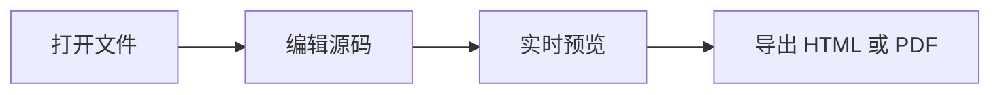

# 墨台使用说明

源码在左侧，实时预览在右侧。文档保存在本机。

使用顶部菜单和工具栏编辑文档，拖动分隔线可调整宽度。

## 预置 Markdown

桌面版的使用说明、图表示例和完整演示放在 EXE 旁的 `builtin/` 目录。
可以直接维护这些文件，也可放入自己的 Markdown，再从“帮助”菜单选择打开。
Ctrl+S 更新当前原稿；使用预置内容写新文档时，请按 Ctrl+Shift+S 另存为。

## Mermaid 流程图



## 常用操作

| 功能 | 你可以做什么 |
| :--- | :--- |
| 实时预览 | 对照源码和排版，双向同步滚动 |
| Mermaid | 流程图、时序图、类图、甘特图 |
| 本地文件 | 打开文件，保存 Markdown，自由迁移 |
| 导出文件 | 独立 HTML、带目录的 PDF 文件 |

> 图表模板位于「插入」菜单。左侧「Mermaid 示例集」包含更多图表。
> 完整语法与内置演示位于「帮助 → Markdown 全功能演示」，按需打开即可。

## 任务列表

- [x] 打开文档
- [x] 检查图表
- [ ] 保存文件

## 代码高亮

```javascript
const filename = 'README.md';
console.log(filename);
```
